---
title: "Midterm Project"
output:
  xaringan::moon_reader:
    lib_dir: libs
    nature:
      highlightStyle: github
      highlightLines: true
      countIncrementalSlides: false
   

---

```{r setup, include=FALSE}
options(htmltools.dir.version = FALSE)
```

```{r xaringan-tile-view, echo=FALSE}
xaringanExtra::use_tile_view()
```


```{r xaringan-panelset, echo=FALSE}
xaringanExtra::use_panelset()
```

```{r, echo=FALSE}
xaringanExtra::use_webcam()
```

```{r xaringan-fit-screen, echo=FALSE}
xaringanExtra::use_fit_screen()
```


# Table of Contents

1. Data Visualization 

2. Predictive Models 

3. Errors/Challenges

4. Conclusion 


---

class: inverse, center, middle

# Data Visualization

---
class: center
# Background of Data
- For this project, we used Rhode Island Department of Health Hospital Discharge Data. 
- Goal of creating visuals is to gain insights and conclusions. 
- This data has been filtered to only the year 2018. 

---
class: center 

```{r, echo=FALSE, out.width="70%"}
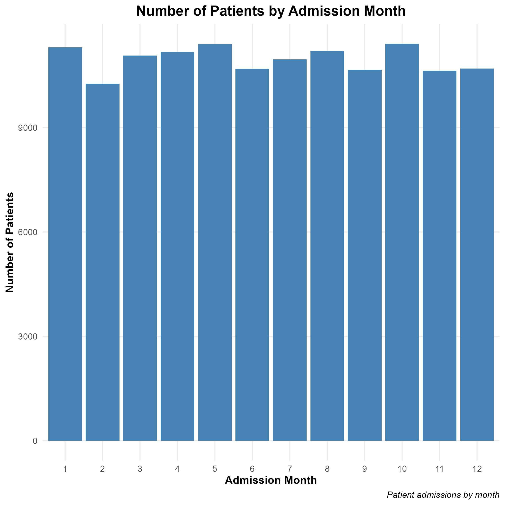
```


- The image above is representing the number of patients they have admitted per month.
- They are all relativley even with Febuary being the lowest number of patients admitted. 

---
class: center
```{r, echo=FALSE, out.width="70%"}
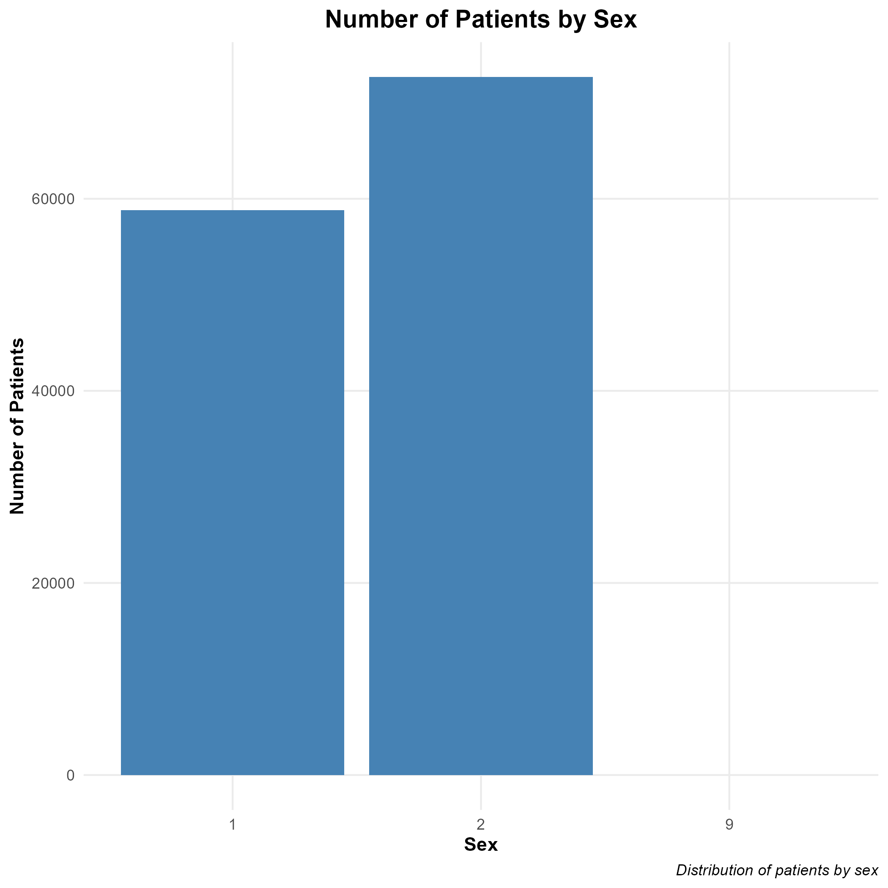
```

- This plot is comparing number of patients that are male versus the number of patients that are female
- As shown, there is more female admitted patients than male admitted patients. 

---

class: center

```{r, echo=FALSE, out.width="70%"}
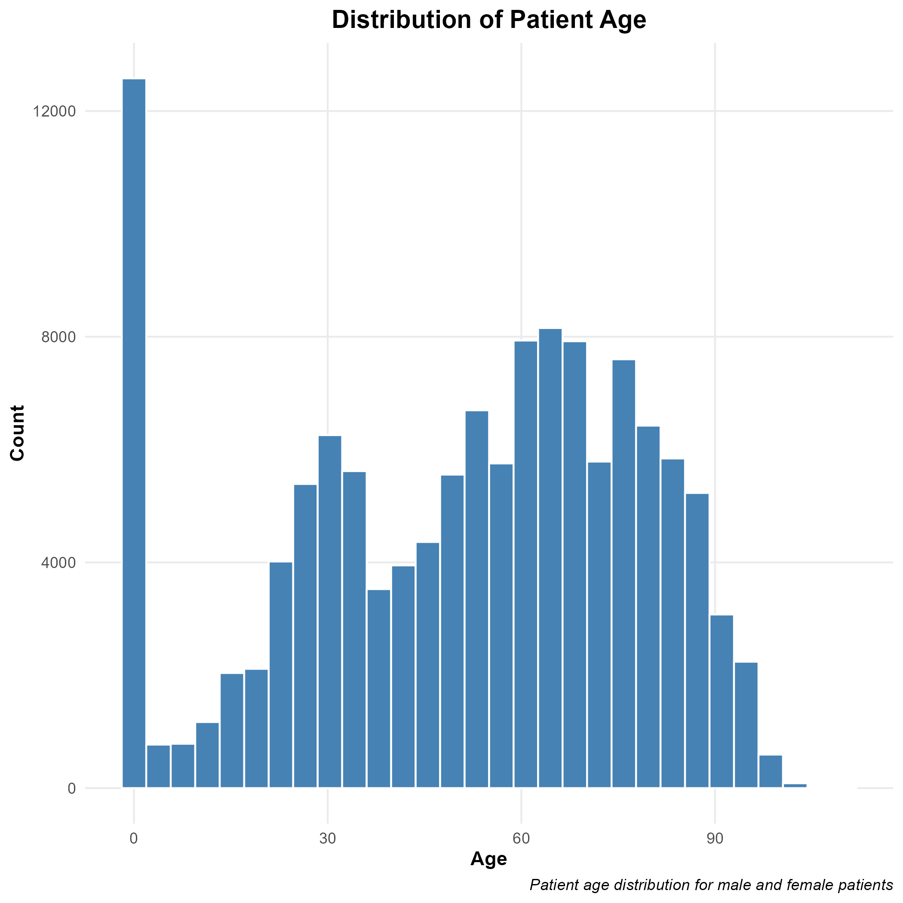
```
- This is showing the distribution of patient age.
- It is skewed slightly toward older patients.
- There is a lot that are at the zero marker, which could indicate that some patient ages were not recorded. 
---

class: center

```{r, echo=FALSE, out.width="70%"}
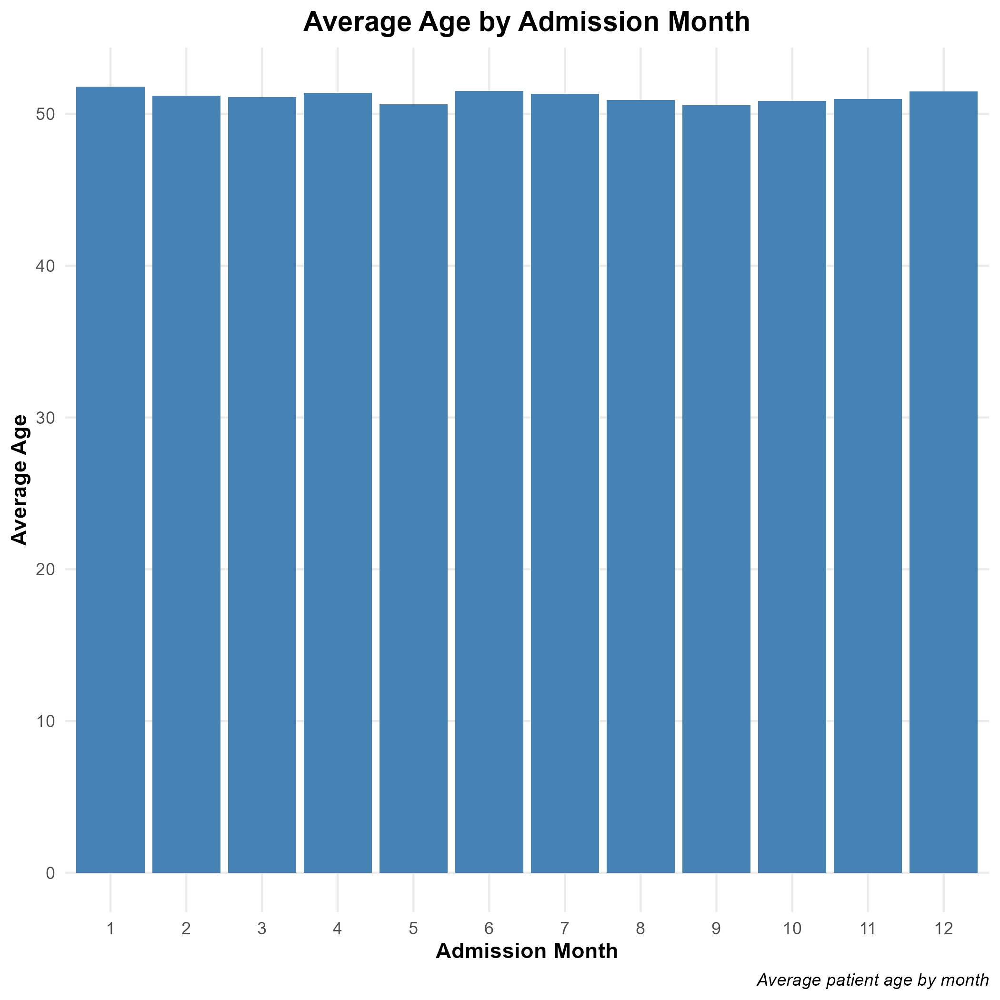
```
- This is showing the average patient age by the admission month
- They are all fairly close together and we can conclude that the average patient age is not influenced by admission month. 


---

class: center

```{r, echo=FALSE, out.width="70%"}
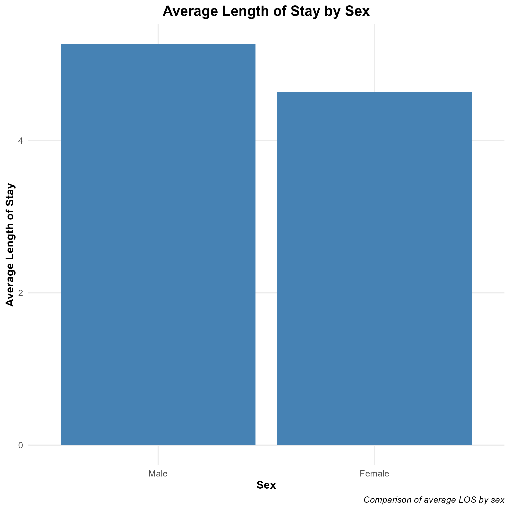
```

- This plot is showing the length of stay by sex. 
- Males have a longer average length of stay compared to females.


---
class: center

```{r, echo=FALSE, out.width="60%"}
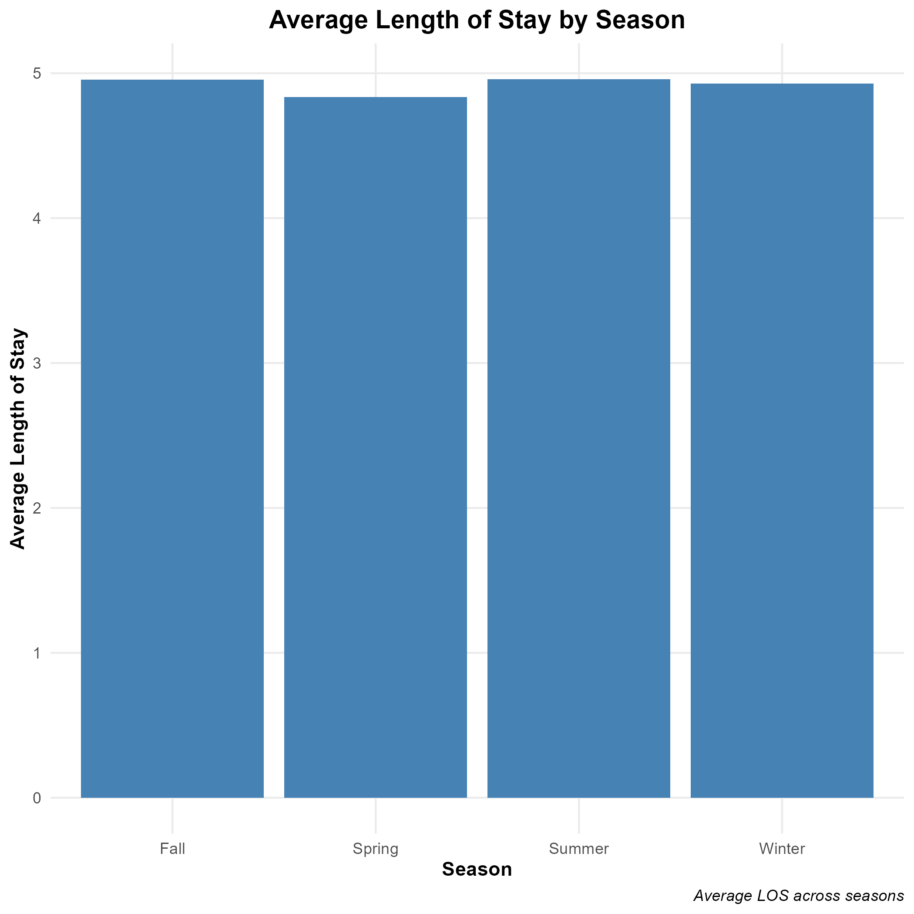
```

- This graph is showing the average length of stay by season
- We can conclude that they are all roughly the same, with Spring having the lowest average. 
- Overall, season does not seem to have much of an impact on the length of stay.


---
class: center
```{r, echo=FALSE, out.width="70%"}
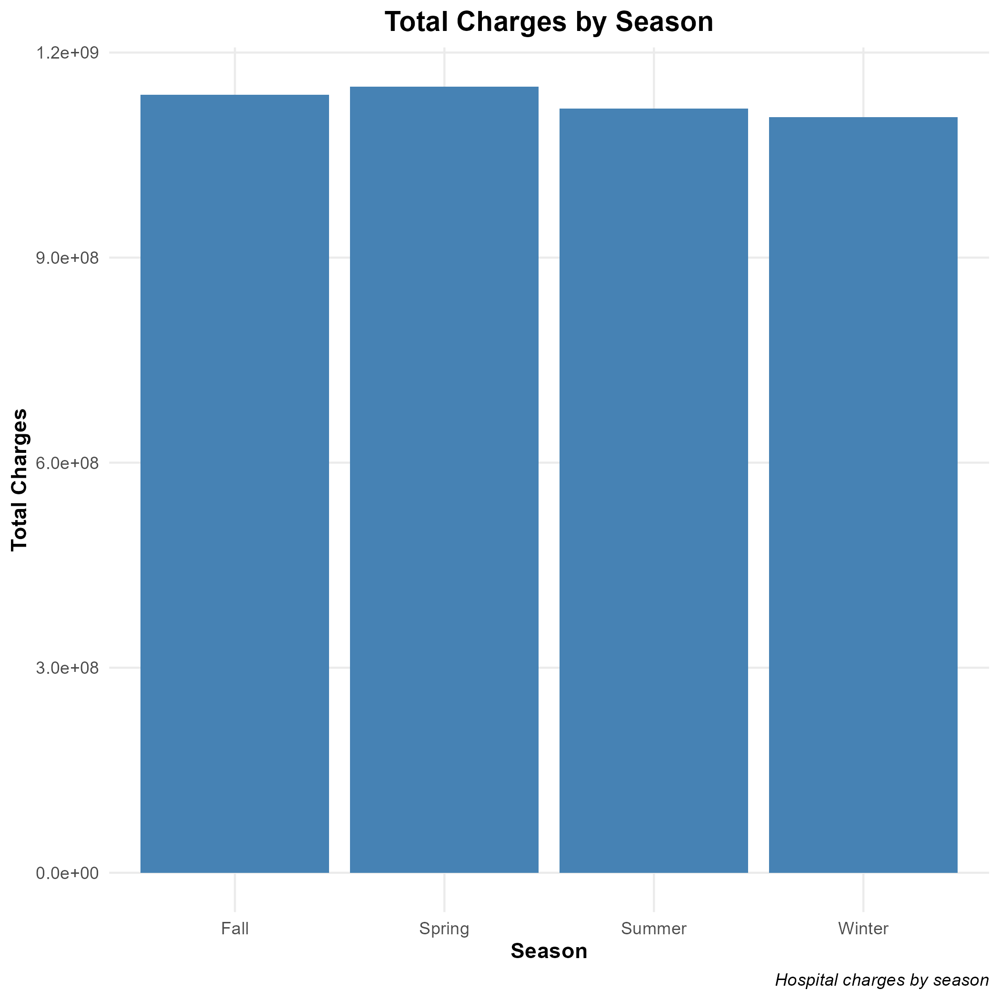
```

- This is showing the total charges by season
- We can conclude that they are all within the same area, with winter having the lowest total charge compared to the others. 

---
class: center
```{r, echo=FALSE, out.width="70%"}
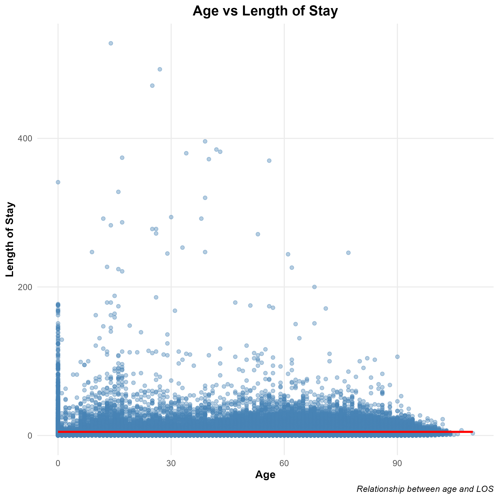
```

- This graph is showing the relationship between age and the length of stay. 
- There is no linear relationship between age and length of stay according to this graph. 


---
class: center
```{r, echo=FALSE, out.width="70%"}
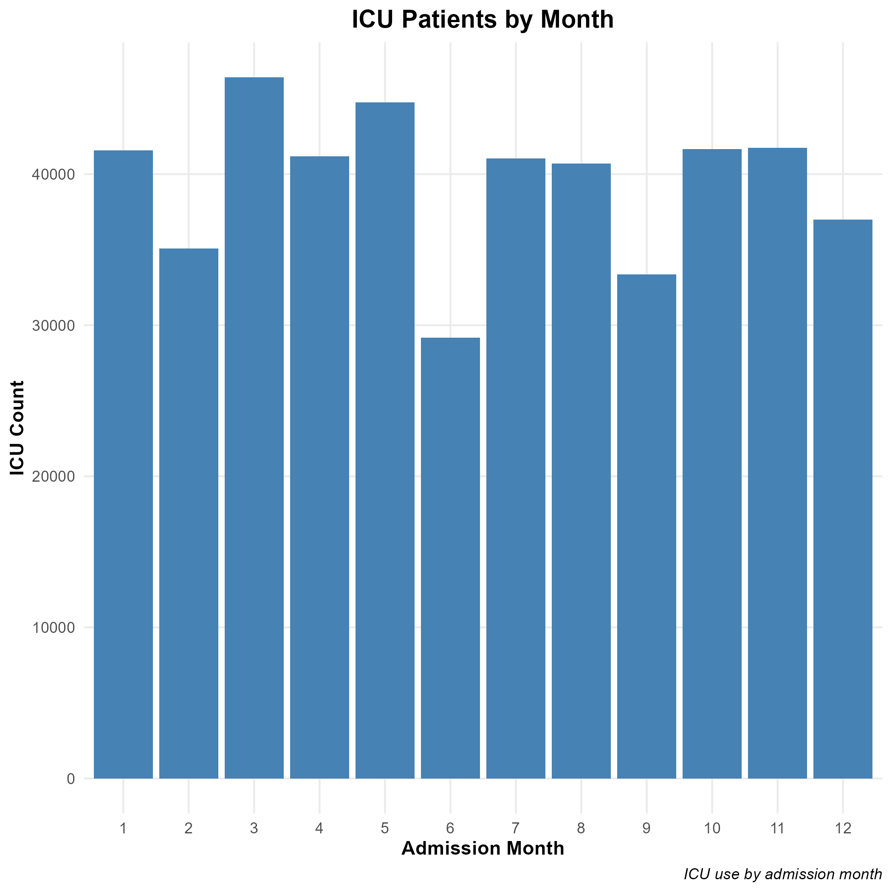
```
- This graph is breaking up the months to see the total ICU patients in the different months
- The month of June in 2018 has the lowest amount of patients in the ICU and March of 2018 had the most in that year


---
class: center

```{r, echo=FALSE, out.width="70%"}
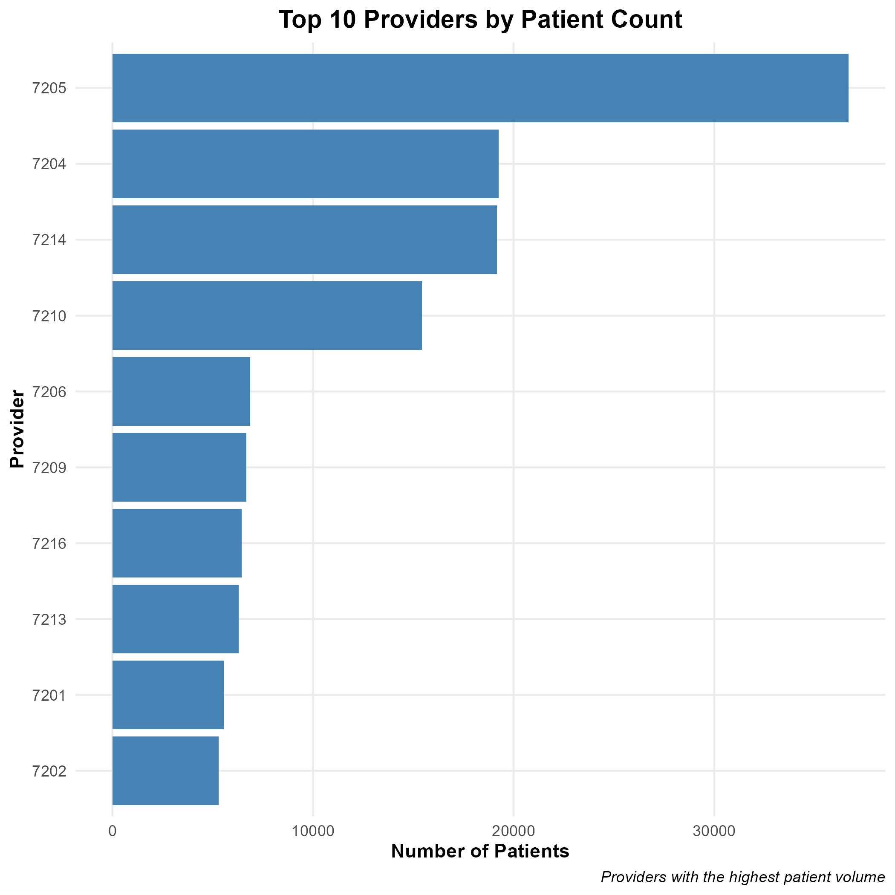
```
- This graph is showing the top ten providers based on the patient count
- There is a very obvious top provider, that being 7205


---
  
# What Can We Conclude From Those Graphs? 
  
The visualizations show how admissions vary by month, differences between male and female patients, age distributions, seasonal patterns in length of stay, and variations in charges across providers. 

Overall, the graphs are proving that patient characteristics and admission timing can influence hospital utilization and costs, while also helping to identify patterns and trends throughout the data set.


---
class: inverse, center, middle

# Predictive Modeling 

---
  
# Graphs for Total Charge Target Variable
  
  
Made a Decision Tree and KNN (K-Nearest Neighbors) Model
  - Decision Tree: makes prediction based on a series of if-then statements. Continues to follow the branches until it reaches the final one where it belongs. 

  - KNN Model: Chose a value for K, calculates distance between new observation and all observations in the training data, then finds the K closest observations to make a prediction based on those neighbors. 
  
  
---
class: center
# KNN vs. Decision Tree Comparison for Total Charge Target

```{r, echo=FALSE, out.width="80%"}
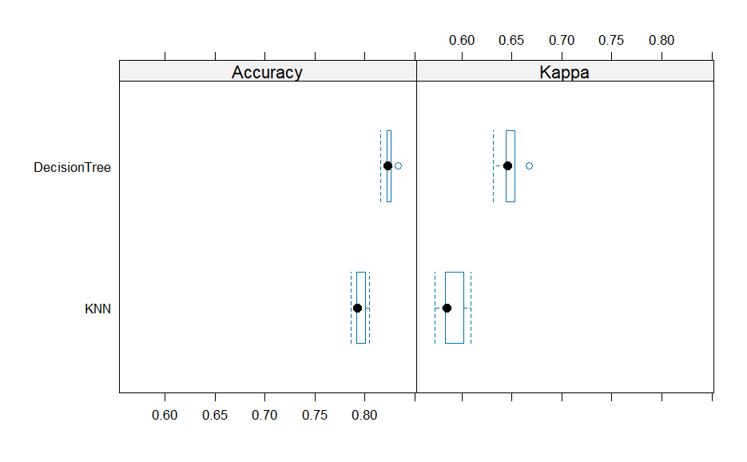
```

I chose the Decision Tree because it had the higher accuracy 
of approximately 82.29%
  
  
---
#Length of Stay Target Variable 
- For the new target variable, I chose Length of Stay Level Variable (long vs. short)
- Repeated the same process from previous target variable for this one 
- Below shows the variables most influential to the length of stay 
```{r, echo=FALSE, out.width="80%"}
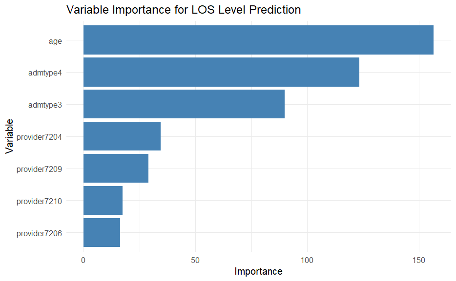
```
---
class: center
# Length of Stay Target Variable 

```{r, echo=FALSE, out.width="80%"}
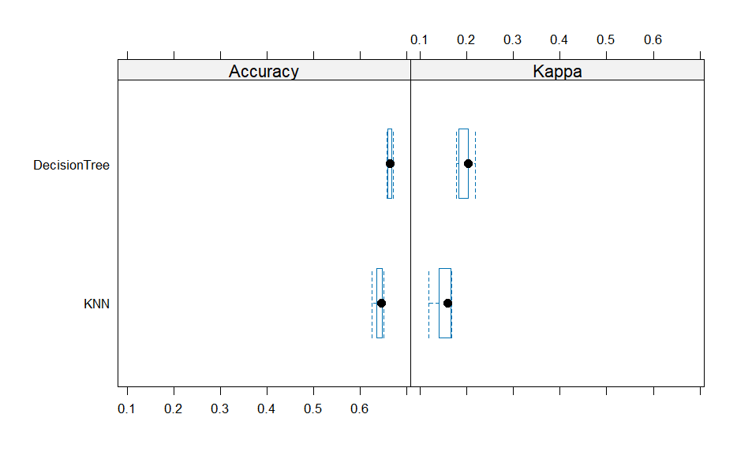
```

I would chose the Decision Tree because it has the higher accuracy of approximately 66.03%. 
  
---
class: center

#Summary of Length of Stay 

The process was repeated using a new target variable based on length of stay, classifying patients into short-stay and long-stay groups. The results demonstrated that patient charcteristics like age, admission information, and provider-related variables can be useful for predicting healthcare outcomes, while model comparison helped identify the most effective predictive approach for the dataset.
  
  
  
---
class: inverse, middle, center

# Challenges 

---
class: center 

# Challenges 
- Creating plots that were all drawing different conclusions 
  
- Saving the comparison plots 
  
- Resizing the images within the presentation.
  
---
class: center

# Conclusion 

The midterm project allowed me to make data driven conclusions, visualize what was in the data, and make predictions based on models. 

---


  
  
  

